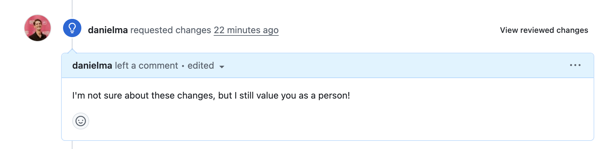

# Gentle Request Changes

A Chrome extension that reframes GitHub's "request changes" review from something alarming into
something helpful.

## Screenshots

Sidebar:

Timeline:

- **Calm blue lightbulb.** The red "requested changes" icon in the PR timeline, the Reviewers
  sidebar, and the merge box becomes a blue lightbulb, using GitHub's own accent colors so it
  follows your light/dark theme.
- **Hide "Comment" (optional).** A checkbox in the toolbar popup hides the "Comment" choice when
  submitting a review. Because GitHub's classic form pre-selects "Comment", the extension blocks a
  submit while that hidden choice is still selected and asks you to pick Approve or Request
  changes instead.

## Install

1. Open `chrome://extensions` and turn on **Developer mode**.
2. Click **Load unpacked** and choose this folder.
3. Pin the extension and click it to toggle "Hide the Comment option".

## Testing

Open `test/fixture.html` through any static server (from this folder,
`python3 -m http.server 8765`, then visit `http://localhost:8765/test/fixture.html`). It stubs
`chrome.storage`, loads the real content script, and shows the expected result next to each case.

## How it finds things

GitHub changes its markup often, so `src/content.js` uses two layers:

1. Exact selectors for markup seen on github.com today (timeline badge, Reviewers sidebar).
2. A heuristic for everything else: a red X or diff icon is softened only when the smallest nearby
   container that mentions requested changes is short and contains no other red icon.

If something stops matching, start with `KNOWN_ICON_SELECTORS` in `src/content.js`. To try a
different icon, swap `LIGHT_BULB_PATH` for any 16px [Octicon](https://primer.style/octicons) path.
